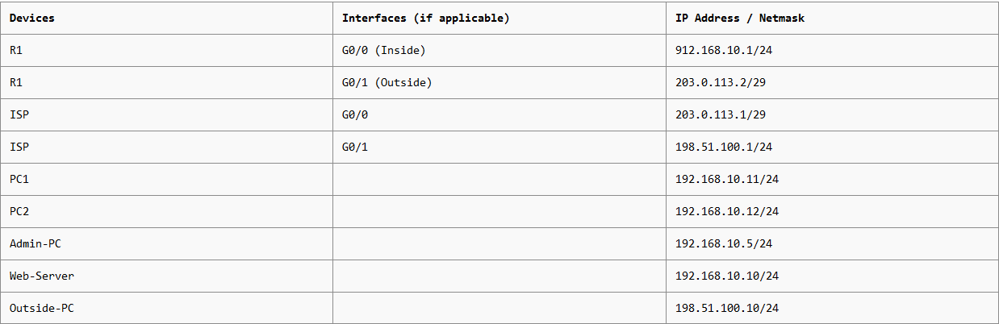
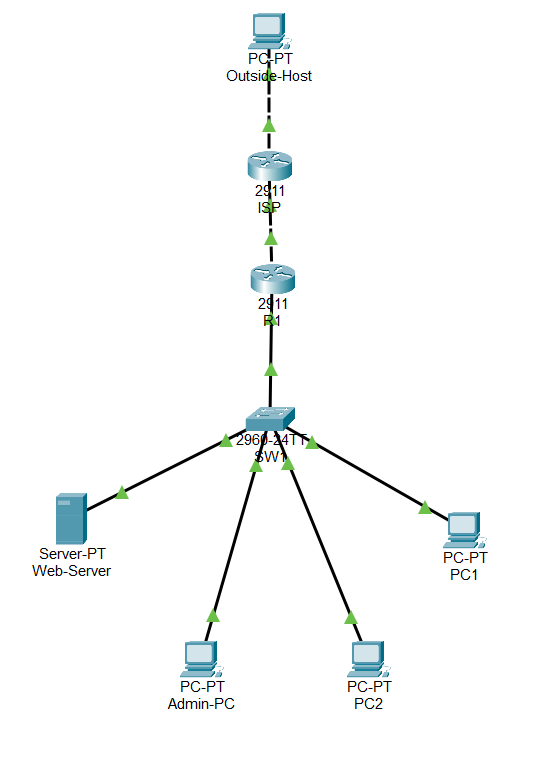
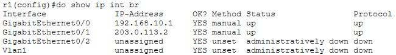
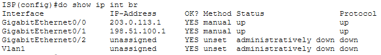

# Topology & Addressing

## Environment
- Cisco Packet Tracer
-Two Cisco 2911 Integrated Services Routers: R1 (edge router performing NAT and ACL enforcement) and ISP (simulated internet router)
- One Cisco Catalyst 2969 switch (SW1) connecting the inside network
- Inside Hosts: two user PCs (PC1 and PC2), one admin PC (Admin-PC), and one web server (Web-Server)
- One outside host (Outside-PC) beyond the ISP router, used to test NAT and ACL behavior from the 'internet' side of things

## Addressing PLan
- Network Address Table: 

## Design Notes
- The outside network will use 203.0.113.0/29 and 198.51.100.0/24, both of a range commonly reserved for documentation, so they are more than safe to use in the lab
- the /29 on the R1-to-ISP link leaves a spare public address beyond R1's own: 203.0.113.2 is the shared address for PAT, and 203.0.113.3 is reserved for the public address for the static NAT mapping to the web-server
- The inside network uses the 192.168.10.0/24 class c private address range
- The ISP has no route to the private inside network, much like in the real world. Inside hosts will not be able to reach the 'outside' network until NAT translates their individual addresses

## Verification
- Network Topology: 

- IP Interface Brief on R1: 

- IP Interface Brief on ISP: 

## Additional Notes
- Non-issue: Endhosts in packet tracer don't have any addressing at all, requiring manual setup. Including static IP, netmask, and default gateways for each host. 
- Takeaway: Planning the addressing scheme ahead of time compared to working backwards is important for not wasing time and having a solid point of reference.

