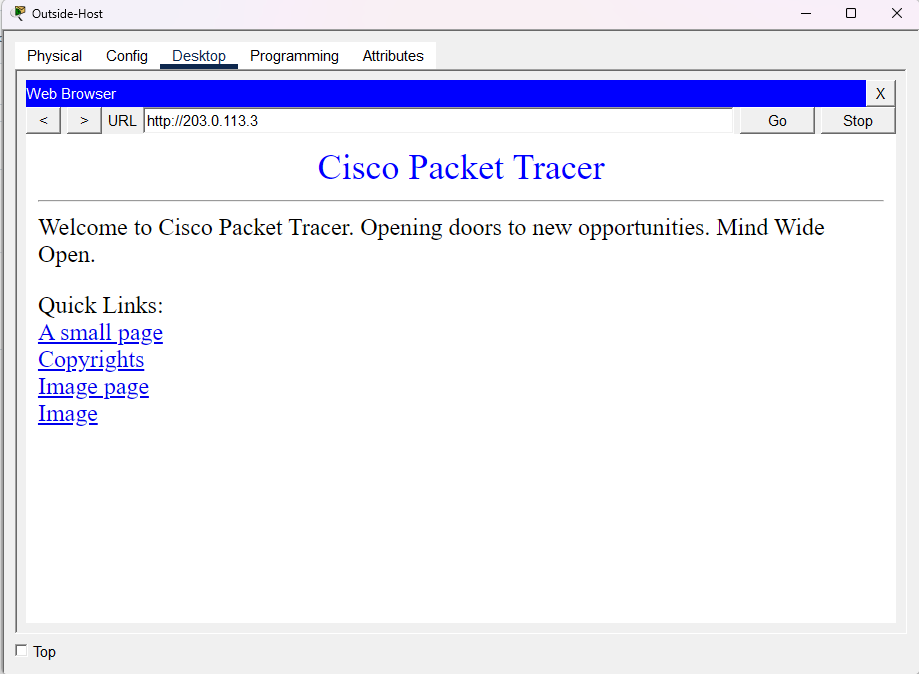

#Static Network Address Translation (NAT)

## Purpose
Expose the internal Web-Server (192.168.10.10) to outside hosts beyond the internal network through a fixed public address without exposing th eprivate address.

## Configuration
- Inside/outside interface roles on R1 (G0/0 inside and G0/1 outside)
- Static mapping: 192.168.10.10 <-> 203.0.113.3

## Verification
- Outside-PC reaches the web server at 203.0.113.3

- IP nat translations output

- Outside-PC cannot reach 192.168.10.10 directly

- PC1 still cannot reach the outside

