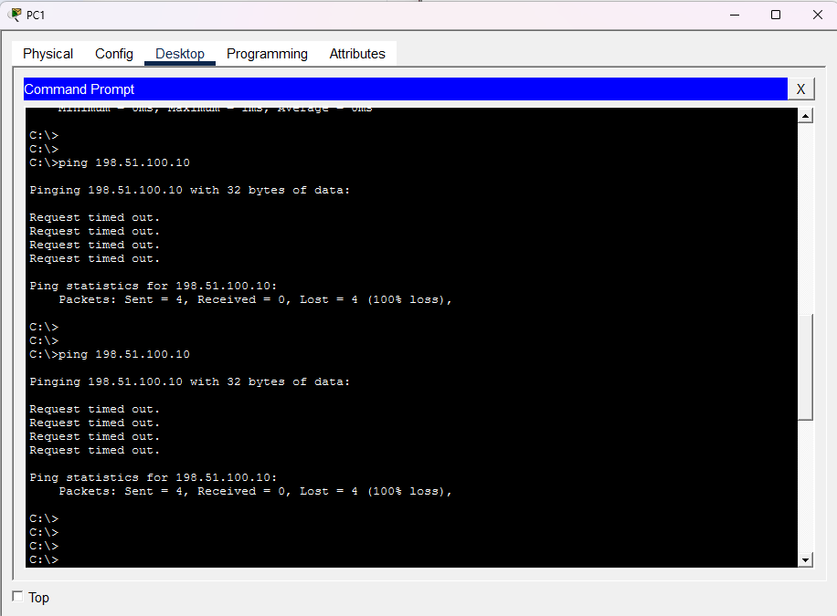
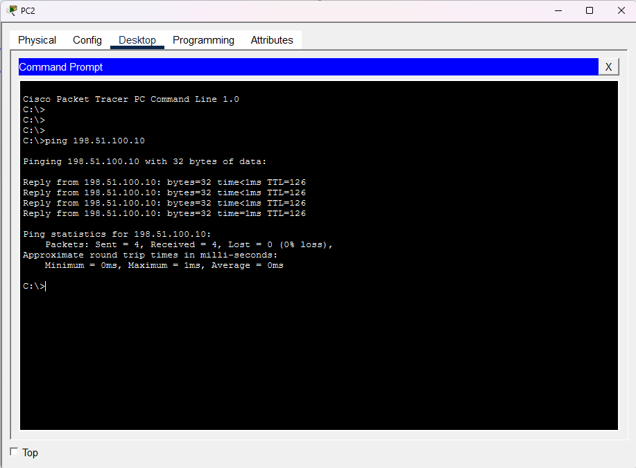
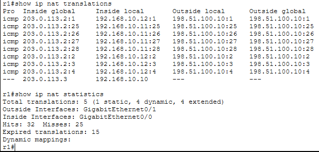

# Port Address Translation (PAT) or NAT Overload

## Purpose
Allow inside hosts of the internal network to reach the outside network through a single shared public address (203.0.113.2) using port translation to keep simultaneous connections distinct

## Configuration
- Standard ACL NAT-INSIDE identifies which inside addresses are eligible for translation (192.168.10.0/24). This is not a security ACL, that will be configured later.
- PAT rule translates matching traffic to R1's outside interface address using the overload keyword in the configuration commmand
- Static NAT entry for the web-server remains in place and takes precedence for that host

## Verification
- PC1 to Outside-PC ping failed before PAT, and now it succeeeds: 

- PC2 to Outside-PC ping failed before PAT, and now it succeeeds: 

- Show ip nat translations and statistics showing functional PAT, with PCs sharing 203.0.113.2 address: 

