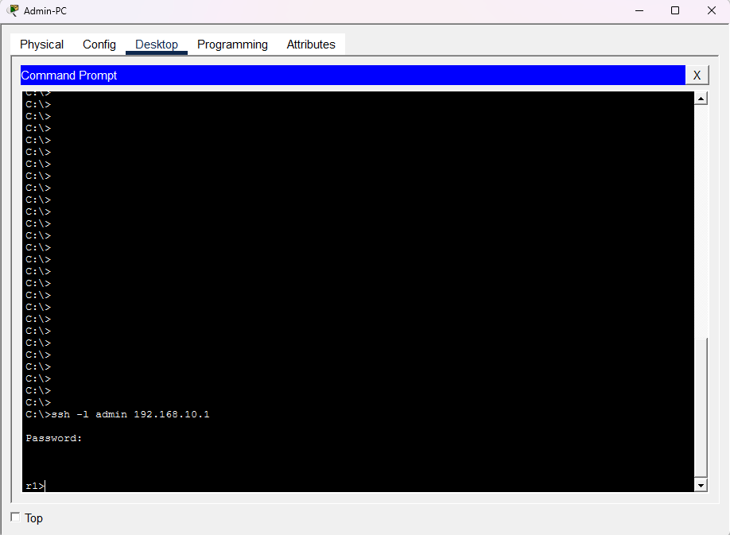
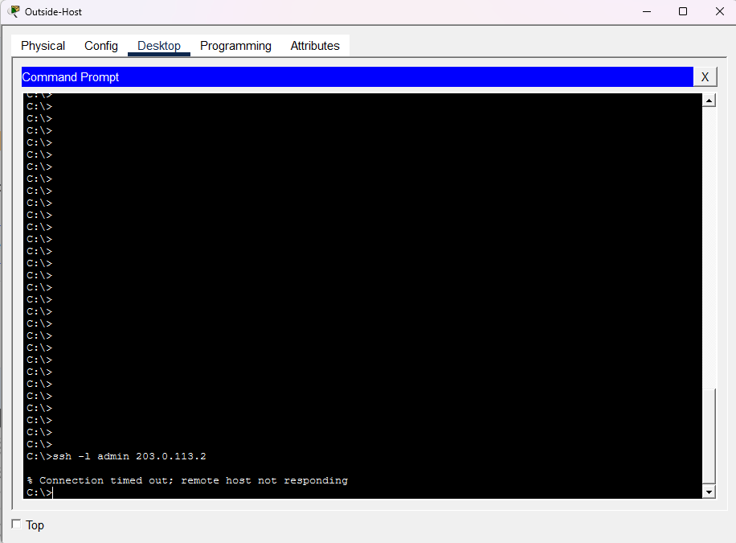
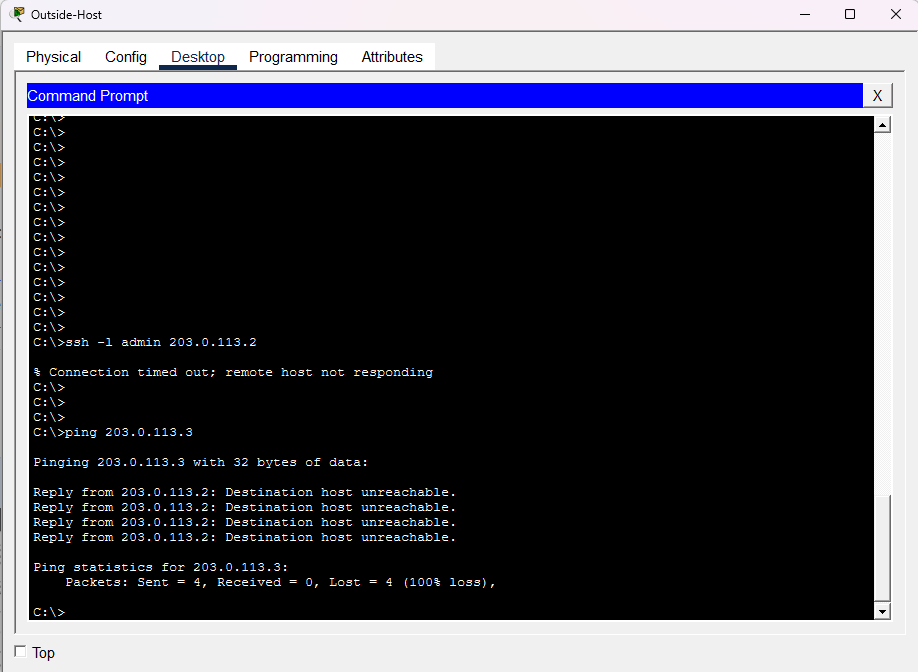
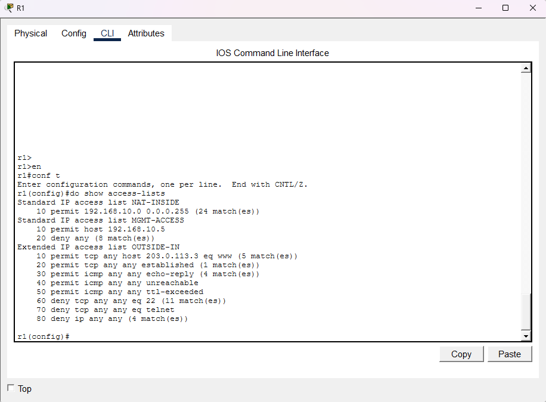

# Access Control List (ACL) Security Controls

## Design
- MGMT-ACCESS (standard acl applied to vty lines): only Admin-PC may manage R1
- OUTSIDE-IN (extended ACL, applied inbound on R1's outside interface): outside hosts can reach the web server over http, and replies to connections started from the inside are allowed as return traffic. Otherwise denies and increments counters for denied traffic.
- Full configurations exist in the 'configs/router-config.txt'

## Configuration
- Enabled SSH on R1 and confirmed it worked from Admin-PC before adding any access restrictions to avoid locking myself out should any initial misconfiguration occur
- With the baseline established I applied the MGMT-ACCESS access-list to the VTY lines using access-class
- Applied OUTSIDE-IN inbound on the outside interface, with explicit deny rules for SSH and Telnet so blocked attempts get their own match counters

## Key Concepts
- The inbound ACL on the outside interface sees the public address (203.0.113.3), not the server's private one, filtering traffic before NAT translates allowed traffic to the destination
- Access-class filters who can connect to the router itself, while access-group filters traffic passing through the individual interfaces, inbound or outbound
- Return-traffic rules are needed so replies to PAT connections are not dropped by the finaly deny any any configuration

## Verification
- Admin-PC SSH to R1 was allowed

- PC1 SSH to R1 was denied

- Outside-PC SSH to R1 was denied

- Outside-PC ping to 203.0.113.3 now denied under the current implementation of the ACL

- Active Access-Lists

