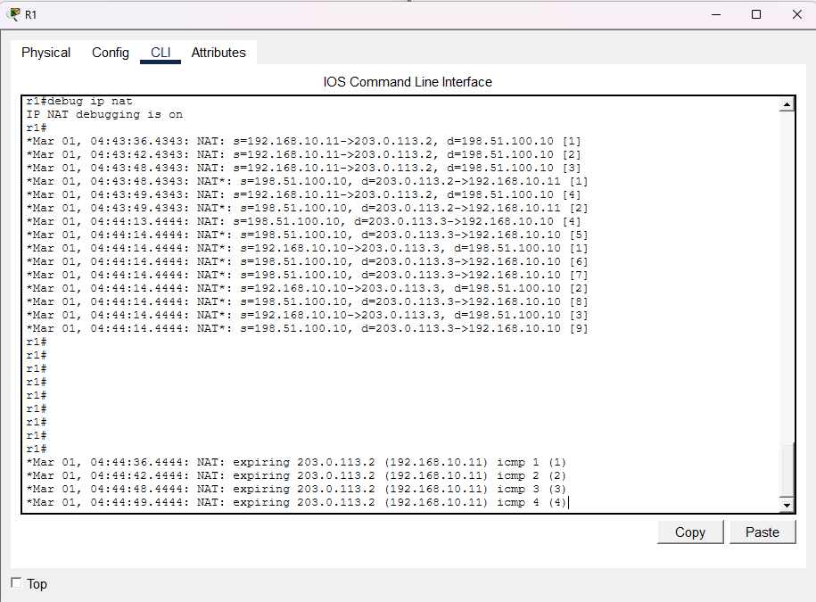
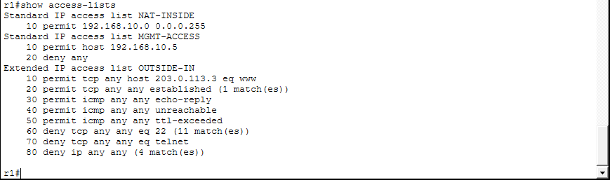

# Logging

## Design
- Created a Syslog-Server on the inside network to collect R1's messages; R1 also temporarily kept a local buffer with timestamps for testing purposes
- NAT activity captured through NAT logging and debugging output, Cisco Packet Tracer has limited support as a simulator
- ACL activity was evidenced through match counters after clearing ACL counters, CPT does not support the log function in ACL rules

## Steps
- Enabled timestamps, buffered logging, and a syslog host server
- Confirmed the pipeline by bouncing an interface and checking the syslog server for logging entries
- Captured NAT translation while generating internal and external network traffic
- Triggered a number of denied traffic flows and captured matching ACL counters

## Verification
- NAT debugging on R1

- ACL counters after clearing and verifying function

## Additional Notes
- Issue: Severity options for the logging buffered and trap options were not accepted by CPT, nor were they an option after checking with the ? help option
- Fix: Implemented mostly similar logging with the default level 7 debugging option, and relied on using ACL counters and debugging ip nat logs for verification.
- Issue 2: Attempted to add the log option to ACL firewall rules after removing the existing deny rules, but the CPT does not support ACL logging
- Fix: Restored the removed rules and verified ip access-lists were in their original state
- Takeaway: Confirm a feature is supported before deleting any sort of configuration, though on a real-world router adding the log keyword would function normally and send them to the configured syslog server

