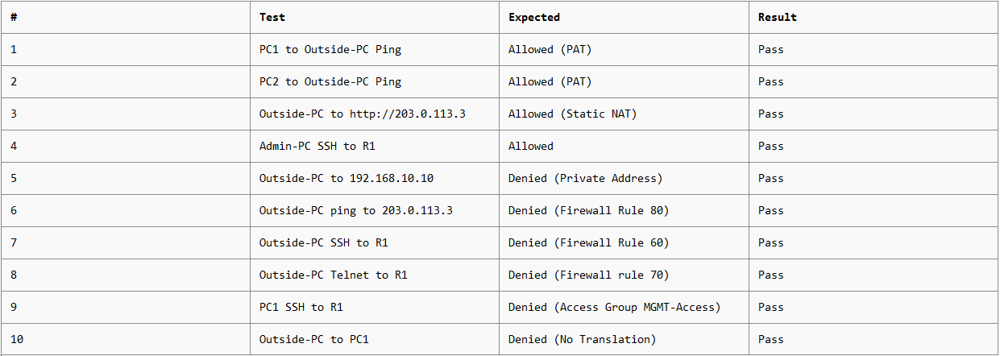
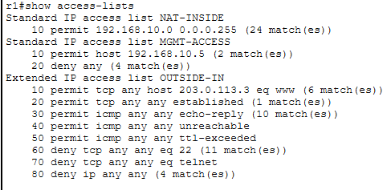
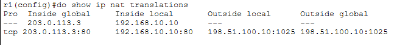

# Test Cases

## Final Approach
Final Regression testing against the completed lab configuration focusing on IP Nat translationa and ACL counters, cleared beforehand. Each test covers an allowed or denied flow in the lab configuration and is tied to a relevant mechanism per the network topology

## Results
- Test Case Matrix Results

## Evidence
- Test Case ACL Counters

- Test Case Translations

## Observations
- The ping for the web server's public address worked before the OUTSIDE-IN access list and is now denied afterward
- Test cases did not diverge from their expected results

## Additional Notes
- It helped to pull up the network address table outlined in doc  01 for the ping commands and attempting to ssh into the correct internal or external interface on R1
- Needed to double check the documentation for the correct secret password I'd assigned to the admin account
